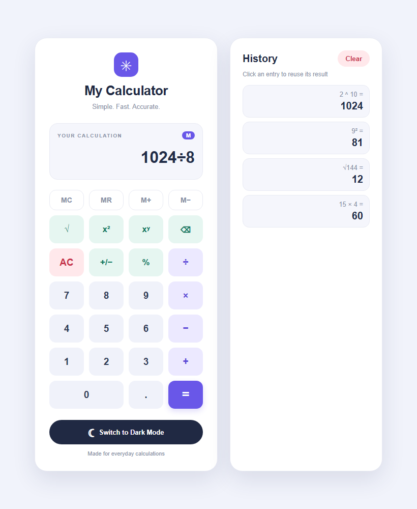
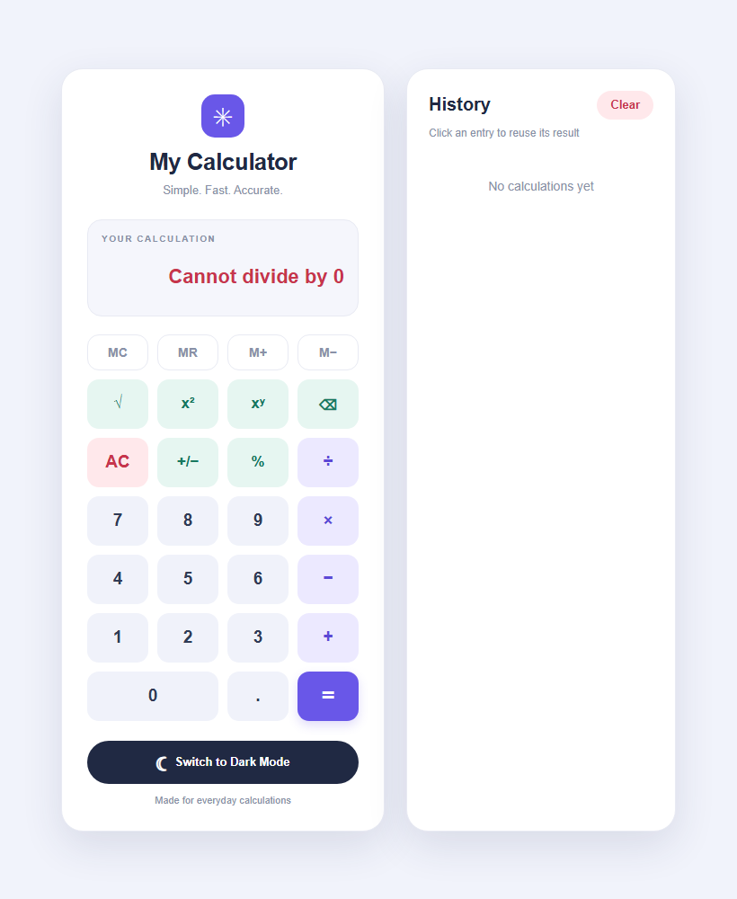
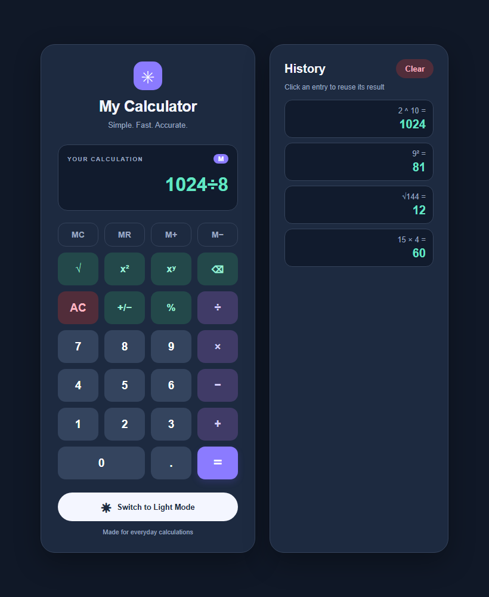

# My Calculator

An advanced calculator built using HTML, CSS and JavaScript, with scientific operations, a calculation history panel, memory functions and dark/light mode.

## Features

### Basic operations
- Addition, subtraction, multiplication and division
- Correct order of operations (2 + 3 × 4 = 14)
- Decimal numbers, delete (⌫) and clear (AC)

### Scientific operations (new)
- **Percentage (%)**: turns the current number into a decimal percentage (50% → 0.5)
- **Sign toggle (+/−)**: switches the current number between positive and negative
- **Square root (√)**: square root of the current value
- **Square (x²)** and **power (xʸ)**: square a value or raise it to any power (2 ^ 10 = 1024)

### Error handling (new)
- No more `Infinity` or `NaN`: friendly messages such as **"Cannot divide by 0"**, **"Cannot take √ of a negative"** and **"Number too large"**
- The error message clears automatically on the next key press
- Expressions are evaluated by a small built-in parser instead of `eval`/`Function`
- Rounds floating-point noise (0.1 + 0.2 shows 0.3)

### Calculation history panel (new)
- Side panel records every completed calculation (e.g. `15 × 4 = 60`)
- Click any entry to load its result back into the display
- **Clear** button wipes the stored history
- History is saved in the browser, so it survives a page refresh
- On small screens the panel moves below the calculator

### Memory functions (bonus)
- **MC**: clear memory
- **MR**: recall the stored value into the display
- **M+** / **M−**: add or subtract the current value to/from memory
- An **M** badge appears in the display while a value is stored

### Dark / light mode

## Keyboard Shortcuts

| Key | Action |
| --- | --- |
| `0`–`9`, `.` | Enter numbers |
| `+` `-` `*` `/` `^` | Operators |
| `Enter` or `=` | Calculate |
| `Backspace` | Delete last character |
| `Esc` or `Delete` | Clear |
| `%` | Percentage |
| `R` | Square root |
| `S` | Square |
| `N` | Toggle sign |

## Technologies Used

- HTML
- CSS
- JavaScript

## How to Run

Open the index.html file in a web browser.
